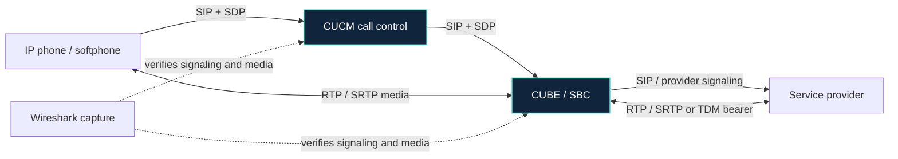

**A source-linked field guide for engineers who build, troubleshoot, and explain enterprise voice systems.**

[Explore the docs](docs/index.md) · [Browse Wireshark filters](docs/wireshark/voice-display-filters.md) · [Find RFCs](docs/standards/rfc-catalog.md) · [Contribute](CONTRIBUTING.md)

---

## What this project is

**Voice Collaboration Core Knowledge** is a practical, version-aware reference for SIP and enterprise communications engineering. It connects protocol standards to Cisco and SBC implementation guidance, then turns them into repeatable troubleshooting workflows.

It is designed for **CCNP / CCIE Collaboration study, senior voice-engineer interviews, lab building, and evidence-led customer troubleshooting**. It links to sources of truth and adds original explanations, filter examples, checklists, and runbooks—not a mirror of vendor manuals or paid courses.

## Pick your path

<table>
<tr>
<td width="50%" valign="top">

### 🧭 Understand the standards

Start with SIP transactions, SDP offer/answer, RTP/RTCP, SRTP, DNS discovery, telephony events, and PSTN interworking.

[Open the RFC catalog →](docs/standards/rfc-catalog.md)

</td>
<td width="50%" valign="top">

### 🔬 Read the packets

Use display filters, follow signaling legs, compare SDP, and prove whether media packets flow in both directions.

[Open the Wireshark field guide →](docs/wireshark/voice-display-filters.md)

</td>
</tr>
<tr>
<td width="50%" valign="top">

### 🛠️ Troubleshoot like TAC

Separate observed facts from hypotheses; start with read-only verification and make changes in controlled, reversible phases.

[Open the TAC method →](docs/troubleshooting/tac-method.md)

</td>
<td width="50%" valign="top">

### 🔗 Interoperate across vendors

Follow Cisco CUBE, AudioCodes, Oracle, Ribbon, SIPp, SIPsense, and SIP School source maps.

[Open the SBC learning map →](docs/vendors/sbc-training-map.md)

</td>
</tr>
</table>

## The call path we keep proving

> [!IMPORTANT]
> **A completed SIP dialog does not prove that usable media is flowing.** Read the offer/answer, determine the negotiated media address and port, and verify actual packets in each direction. Treat early media, media anchoring, MTP/transcoding, NAT, and SRTP as evidence-driven branches—not assumptions.

## Inside the repository

| Area | What you'll find |
|---|---|
| [Standards](docs/standards/rfc-catalog.md) | Curated voice-related RFC index and CSV inventory |
| [Cisco CUBE](docs/vendors/cisco-cube-ios-xe-17-6.md) | IOS XE 17.6+ and cross-vendor SBC references |
| [Wireshark](docs/wireshark/voice-display-filters.md) | SIP, TCP, SDP, RTP/RTCP, DNS/SRV, and TLS display filters |
| [Troubleshooting](docs/troubleshooting/tac-method.md) | SIP timeline analysis, RTP one-way audio, and TAC workflow |
| [Security](docs/security/voice-security.md) | TLS, certificates, identity, SRTP and security checks |
| [PSTN / TDM](docs/pstn/voip-to-tdm.md) | VoIP-to-TDM and PRI integration concepts |
| [Automation](docs/automation/voice-automation.md) | APIs, Python, test scenarios and automation starting points |
| [AI agent guidance](docs/agent/copilot-agent-addendum.md) | Instructions for grounding a technical Copilot agent |

## Engineering principles

- **Evidence before conclusions.** Say what the capture, configuration, or log demonstrates—and what remains unproven.
- **Version before commands.** Match hardware, software train, feature, licensing, and configuration mode.
- **Standards and vendor behavior are different layers.** An RFC defines protocol behavior; vendor documentation explains an implementation and its constraints.
- **Inspect both call legs.** An SBC/B2BUA may generate different Call-IDs, tags, SDP, and transactions on the egress leg.
- **Verify media independently.** Correlate SDP against actual RTP/SRTP, sequence numbers, timestamps, packet rates and capture location.
- **Change safely.** Prefer read-only evidence collection, scoped changes, explicit success criteria, and a tested rollback.

## Publish the searchable documentation site

The repository includes a MkDocs Material site and GitHub Actions workflow. After files are pushed, open **Settings → Pages** and choose **GitHub Actions** as the source if Pages is available for this repository. Confirm the Actions build succeeds before relying on the published URL.

If the repository is private and Pages is unavailable under your plan, keep the Markdown source in GitHub and use an authenticated connector or supported private knowledge source. Do not make the entire repository public just to fix a connector limitation.

## Content policy & attribution

- Original writing and curated metadata are licensed under **CC BY 4.0**, unless a file says otherwise.
- RFCs, Cisco documentation, Wireshark documentation, logos, and third-party training links remain subject to their owners' terms.
- Paid course files and copied vendor manuals are intentionally excluded.
- Never commit customer PCAPs, credentials, private keys, tokens, phone numbers, or unredacted production configurations. Use synthetic examples such as `192.0.2.0/24` and `example.com`.

See [source policy](docs/source-policy.md), [contribution guide](CONTRIBUTING.md), and [license](LICENSE).

---

**Protocol truth. Vendor context. Packet-level evidence.**

*Built for engineers who want to explain not only what to type, but why it works.*

