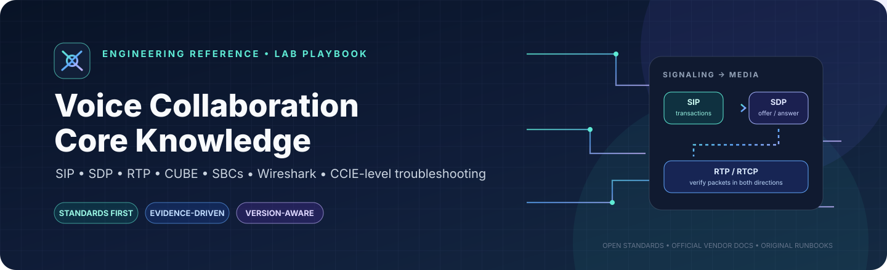

Your guided path · Start with the call · Follow the evidence

# Voice Collaboration Core Knowledge

Welcome to your voice engineering workbench.

This site is designed to take you **from understanding a call, to tracing its packets, to troubleshooting real deployment behavior**. You don't need to know every vendor, RFC, or acronym before starting. Follow the path below; open the deeper reference only when you need it.

[Start the learning path](#the-learning-path){ .md-button .md-button--primary }
[Jump to packet analysis](#the-packet-analysis-workflow){ .md-button }
[Open all reference guides](#reference-library){ .md-button }

---

## First, understand the call

Almost every voice investigation becomes easier when you separate **call control**, **media negotiation**, and **actual media**.

  

    01
    
<strong>SIP — establish and manage the session</strong>
Who called whom? Which requests and responses were exchanged? Did the dialog complete?
Signaling

  

  
↓

  

    02
    
<strong>SDP — agree on media parameters</strong>
Which addresses, ports, codecs, direction attributes and security profiles were negotiated?
Negotiation

  

  
↓

  

    03
    
<strong>RTP / SRTP — prove what actually flows</strong>
Do packets travel both ways? Are sequence numbers, timestamps, packet rate and stream quality reasonable?
Media

  

!!! warning "A completed SIP exchange is not proof of working audio"
    A 200 OK and ACK commonly complete an INVITE exchange, but they do not prove RTP is flowing. Early media may start before that point. Read the applicable SDP and verify the actual packets from an appropriate capture point.

---

## The learning path

Go in order the first time. Later, jump straight to the phase that matches your problem.

-   PHASE 01

    ### Learn the protocol

    Understand SIP methods, transactions and dialogs; SDP offer/answer; RTP/RTCP; DTMF; DNS SRV/NAPTR; and the standards that define the behavior.

    **You should be able to:** explain the purpose of each message and identify what it proves.

    [Explore the RFC catalog →](standards/rfc-catalog.md)

-   PHASE 02

    ### Understand the call path

    Follow an endpoint through CUCM and CUBE/SBC. Learn dial-peer selection, route decisions, SIP legs, header handling, codecs, media anchoring and interworking.

    **You should be able to:** explain what each hop receives, changes and sends onward.

    [Cisco CUBE guide →](vendors/cisco-cube-ios-xe-17-6.md) · [SBC learning map →](vendors/sbc-training-map.md)

-   PHASE 03

    ### Read the packets

    Filter the capture, identify the exact SIP exchange, compare SDP and correlate negotiated media with observed RTP/RTCP.

    **You should be able to:** point to the packet fields supporting your conclusion.

    [Wireshark voice filters →](wireshark/voice-display-filters.md)

-   PHASE 04

    ### Troubleshoot methodically

    Establish the current state, collect read-only evidence, rank hypotheses, test one thing, verify the result, and preserve rollback.

    **You should be able to:** defend the next check and explain what would disprove your hypothesis.

    [TAC method →](troubleshooting/tac-method.md) · [SIP analysis →](troubleshooting/sip-call-analysis.md)

-   PHASE 05

    ### Master real-world edge cases

    Investigate one-way audio, TLS/certificate failures, SRTP, transfers, DTMF, early media, PSTN/PRI and cross-vendor SBC differences.

    **You should be able to:** isolate signaling, media, security, routing and physical-layer failure domains.

    [RTP / one-way audio →](troubleshooting/rtp-one-way-audio.md) · [Voice security →](security/voice-security.md) · [VoIP to TDM →](pstn/voip-to-tdm.md)

-   PHASE 06

    ### Automate and teach

    Turn verified checks into repeatable scripts and test cases. Use the same evidence discipline for quizzes, senior interviews and customer explanations.

    **You should be able to:** reproduce a test, document expected results, and explain the protocol behavior clearly.

    [Voice automation →](automation/voice-automation.md) · [Glossary →](glossary.md)

---

## The packet-analysis workflow

Use this every time you open a voice capture. Resist the temptation to jump straight to a suspected cause.

  
1
<strong>Scope the call</strong>
Record endpoints, timestamps, topology, capture location, software versions, Call-ID(s), and the actual symptom.

  
2
<strong>Filter signaling</strong>
Start with <code>sip</code>. Follow the INVITE, provisional responses, final response, ACK, and teardown as applicable. Remember that a B2BUA may have different Call-IDs on its two legs.

  
3
<strong>Read the SDP</strong>
Compare <code>c=</code>, <code>m=audio</code>, payload types, <code>a=rtpmap</code>, direction attributes and security parameters on each leg.

  
4
<strong>Prove media independently</strong>
Check actual RTP/SRTP packets against the negotiated addresses and ports. Confirm direction, sequence behavior, packet rate, timestamps and quality statistics.

  
5
<strong>State what the evidence proves</strong>
Separate facts, hypotheses and unknowns. Name the next check that would confirm or reject the leading hypothesis.

[Open the full Wireshark filter reference →](wireshark/voice-display-filters.md)

---

## When you're troubleshooting a deployment

Use this engineering checklist before changing anything:

1. **Current state:** intended behavior, actual symptom, impact, topology, software versions and recent changes.
2. **Change:** one small, justified action—prefer read-only checks first.
3. **Why and protocol effect:** explain the hypothesis and which behavior should change.
4. **Expected result and verification:** define success before running the check.
5. **Failure symptom and rollback:** know what a failed test means and how to return safely.
6. **Stop:** if the evidence is ambiguous, collect better evidence before stacking more changes.

This site uses an evidence-first TAC approach. Treat customer systems as production unless clearly identified as labs.

[Read the full TAC troubleshooting method →](troubleshooting/tac-method.md)

---

## Reference library

You do not need to read every guide today. Save this section for when a task takes you deeper.

  <a href="standards/rfc-catalog.md">01<strong>Voice-related RFC catalog</strong><small>SIP, SDP, RTP/RTCP, SRTP, DNS, presence, telephony events and PSTN interworking.</small>↗</a>
  <a href="vendors/cisco-cube-ios-xe-17-6.md">02<strong>Cisco CUBE — IOS XE 17.6+</strong><small>Official guide links, release awareness and call-leg troubleshooting.</small>↗</a>
  <a href="vendors/sbc-training-map.md">03<strong>SBC and SIP training map</strong><small>Cisco, AudioCodes, Oracle, Ribbon, SIPp, SIPsense and packet-analysis learning.</small>↗</a>
  <a href="wireshark/voice-display-filters.md">04<strong>Wireshark voice filters</strong><small>Copyable display filters and an evidence-led analysis sequence.</small>↗</a>
  <a href="troubleshooting/sip-call-analysis.md">05<strong>Packet-by-packet SIP analysis</strong><small>Transactions, dialogs, SDP offer/answer and capture limitations.</small>↗</a>
  <a href="troubleshooting/rtp-one-way-audio.md">06<strong>RTP and one-way audio</strong><small>Separate SDP mismatch, reachability, media resources and capture-point issues.</small>↗</a>
  <a href="security/voice-security.md">07<strong>Voice security</strong><small>SIP TLS, SRTP, certificates, identity and trust boundaries.</small>↗</a>
  <a href="pstn/voip-to-tdm.md">08<strong>VoIP-to-TDM / PRI</strong><small>Physical handoff, signaling, bearer, DSP and gateway verification.</small>↗</a>
  <a href="automation/voice-automation.md">09<strong>Voice automation</strong><small>APIs, structured logs, repeatable tests and safe operational guardrails.</small>↗</a>

---

## Where the information comes from

Use sources for the job they are best suited to:

- **IETF RFC Editor:** protocol standards, status, updates and errata.
- **Official Cisco documentation:** behavior and configuration for the exact product and software release.
- **Official SBC vendor documentation:** implementation-specific configuration and diagnostics.
- **Wireshark documentation:** display-filter syntax and packet dissector behavior.
- **Training and community resources:** useful explanations and leads, but not automatically authoritative for vendor behavior.

The library links to primary sources and adds original notes and runbooks. It does not mirror paid course materials or full vendor manuals.

[Review the source and licensing policy →](source-policy.md)

## Build your own understanding

The goal isn't merely to memorize commands. It is to explain **what happened, which evidence demonstrates it, why the protocol behaved that way, and which safe check comes next**.

  
Your next step

  <h3>Pick one call. Prove one behavior.</h3>
  
Open a lab capture, follow SIP, compare the SDP, and verify the actual RTP. Record what you know, what you suspect, and what you still need to prove.

  <a href="wireshark/voice-display-filters.md" class="md-button md-button--primary">Start packet analysis</a>

